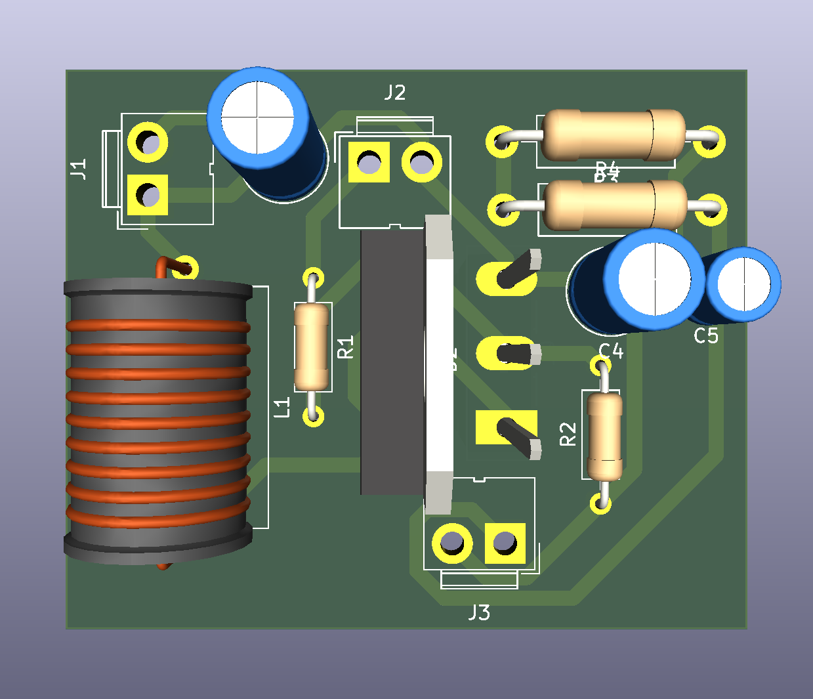

# Boost Converter

A non-isolated boost (step-up) DC-DC converter built from discrete components, designed in KiCad. Made for EE306 Tinkering Lab II at NIT Goa.

## Specs
| Parameter | Value |
|---|---|
| Topology | Non-isolated boost, open loop |
| Input voltage | 12 V |
| Output voltage | 13-24 V (set by duty cycle) |
| Switching frequency | 20 kHz |
| Measured efficiency | ~91 % |
| Gate drive | PWM from a function generator, no controller IC |

## Key components
| Part | Value |
|---|---|
| Inductor | 319 uH, iron-powder core |
| MOSFET | IRFZ44N (55 V, 49 A) |
| Diode | MBRF20100SCT Schottky (100 V, 20 A) |
| Capacitors | 220 uF, 3 uF |
| Gate resistor (R1) | 47 ohm |
| Gate pull-down (R2) | 10 kohm |
| Output resistors (R3, R4) | 200 ohm each |

## Results
- With a 100 ohm load the converter ran in CCM, and with a 200 ohm load in DCM. Measurements matched theory in both cases.
- LTspice simulation agreed with measurements within 1 %.
- Conduction mode, not just duty cycle, sets the conversion ratio of an open-loop boost stage.
- The thermal rating of the dummy load matters as much as any semiconductor rating.

Ideal CCM relation: `Vout = Vin / (1 - D)`

## Preview

[Full PDF plot](docs/buckboostf.pdf)

## Repository layout
`buckboostf/` has the KiCad project (`.kicad_sch`, `.kicad_pcb`), Gerbers and drill files, ready to send to a fab.

## Tools
KiCad, LTspice

## Author
Aayush, EEE @ NIT Goa
